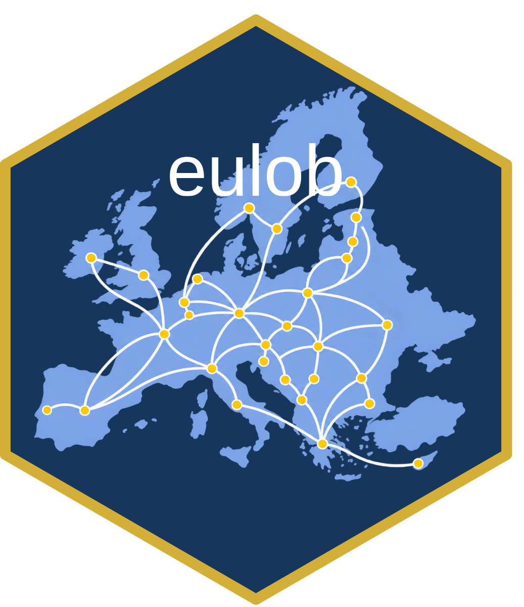

# eulob 

<!-- badges: start -->
[](https://cran.r-project.org/package=eulob)
[](https://github.com/AritzUMA/eulob)
[](https://github.com/AritzUMA/eulob/actions/workflows/R-CMD-check.yaml)
<!-- badges: end -->

## Overview

**eulob** is an R package for exploring lobbying organisations
across Europe through **EU-LOB**, an open and continuously expanding
database. It brings together records from the European Union
Transparency Register, national and regional lobbying and transparency
registers, and publicly documented meetings with institutional
representatives.

The package provides tools to search, retrieve, and compare
organisations across different sources and jurisdictions.
Its exact and approximate name-matching methods help identify
potential correspondences between records despite differences
in naming conventions or spelling.

## Available lobbying registers

The catalogue covers 19 territorial scopes and 21 lobbying registers.

| Code | Country / Territory | Lobbying register |
|---|---|---|
| AT | Austria | Austrian Lobbying Register |
| BE | Belgium | Belgian Chamber Lobby Register |
| CY | Cyprus | Cyprus Lobbying Register |
| CZ | Czech Republic | Czech RELOB |
| DE | Germany | German Lobby Register |
| EE | Estonia | Estonian Lobby Meetings |
| ES | Spain | Spanish CNMC Interest Groups Register |
| FI | Finland | Finnish Transparency Register |
| FR | France | French HATVP Register |
| GR | Greece | Greek Lobbying Register |
| IE | Ireland | Irish Register of Lobbying |
| IT | Italy | Camera dei Deputati |
| IT | Italy | Italian MIMIT Register |
| IT | Italy | Tuscany Interest Groups Register |
| LT | Lithuania | Lithuanian Lobbyists Register |
| LU | Luxembourg | Luxembourg Chamber Interest Representatives |
| LV | Latvia | Latvian Lobbying Register |
| PL | Poland | Polish Professional Lobbying Register |
| RO | Romania | Romanian Lobbying Register |
| UE | European Union | EU Transparency Register |
| UK | United Kingdom | UK Consultant Lobbyists Register |

The code `UE` represents the supranational EU Transparency Register
and is not an ISO country code.

Historical records from the Netherlands (`NL`) are retained outside
the searchable catalogue because the available source does not reliably
identify individual lobbying entities.

Use `eulob_registers()` to inspect the available registers.

## Installation

### Development version (GitHub)

The development version of `eulob` is available from GitHub:

```r
install.packages("pak")
pak::pak("AritzUMA/eulob")
```

To check the installed version:

```r
library(eulob)
packageVersion("eulob")
```

GitHub contains the latest development version selected for
public release. Additional changes may be under development
in the GitLab repository.

### CRAN release

Version 0.2.1 has been submitted to CRAN and is awaiting
review. Once accepted and published, the released version
can be installed with:

```r
install.packages("eulob")
```

## Getting started

Load the package:

    library(eulob)

List available countries and registers:

    eulob_countries()
    eulob_registers()

Explore the Spanish register:

    eulob_registers(country = "ES")
    head(eulob_lobbies(country = "ES"))

Search for organizations:

    eulob_search("association", limit = 10)
    eulob_search("universidad", country = "UE", limit = 10)

Inspect package metadata:

    eulob_info()
    eulob_version()

## Main functions

- `eulob_countries()`: territorial coverage and counts.
- `eulob_registers()`: available lobbying registers.
- `eulob_sources()`: register-level catalogue counts.
- `eulob_lobbies()`: names and register-specific identifiers.
- `eulob_get()`: retrieve entries using a register identifier.
- `eulob_search()`: literal and approximate name searches.
- `eulob_search_normalized()`: normalized-name candidate retrieval.
- `eulob_cross_registers()`: names shared across registers.
- `eulob_info()`: package information.
- `eulob_version()`: installed package version.

## Data structure

The bundled catalogue contains 40,482 normalized name records,
42,599 name-to-register-identifier relationships and
42,265 distinct country-register-identifier keys.

These relationships do not necessarily represent distinct
legal entities.

The name_id field identifies a normalized name.
The lobby_id field contains a source-specific key. Depending
on the register, this may be an official identifier or a
synthetic identifier derived from the source data.

Records can represent different source-level units, including
registrations, participant strings and individual persons.
They should not all be interpreted as independently verified
lobbying organizations.

## Search limitations

The default `eulob_search()` method uses cosine similarity
over character bigrams. Alternative methods include Jaccard,
Jaro-Winkler, Damerau-Levenshtein and case-insensitive literal
substring matching (`method = "fixed"`).

The similarity methods compare textual denominations rather
than semantic representations. High similarity, or the
presence of an identical name in multiple registers, does
not establish that records refer to the same legal entity.
The package does not perform verified cross-register legal
entity resolution.

## Reproducibility

The catalogue is bundled with the package. Collection dates,
data provenance and independent catalogue versioning must
be documented before the first CRAN submission.

## License

MIT License. See DESCRIPTION and LICENSE.
